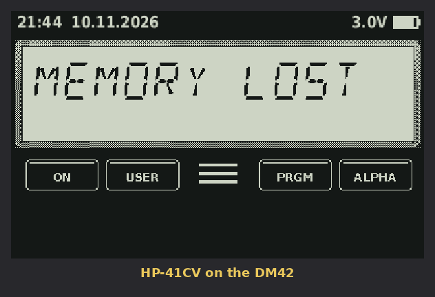

# HP-41CV for the SwissMicros DM42

A clean-room HP-41CV for the DM42 (DMCP 3.14 and newer). It contains no HP ROM code.
The calculator works like a 41CV, but it uses the keys as they are printed on the DM42 (the 42S layout).
41 functions that have no key of their own are in softkey menus under the matching 42S label.

Version 0.2. Not yet tested on real hardware.



*Animation rendered from the emulator core with the same 14-segment renderer the DM42 uses (`tools/demo.c`, `tools/make_gif.py`).*

## Installing

1. Download [`release/HP41CV.pgm`](release/HP41CV.pgm) (v0.1).
2. On the DM42, open SETUP (`SHIFT 0`) → System → Enter System Menu → **Copy to USB disk**,
   then copy `HP41CV.pgm` to the root of the calculator disk. Eject the disk.
3. SETUP → System → Enter System Menu → **Load Program**, and pick `HP41CV.pgm`.
4. To go back to the DM42, load the SwissMicros `DM42-x.y.pgm` the same way. Your DM42 state files are not touched.

The 41's memory is saved to `/HP41CV/STATE.DAT` whenever the calculator turns off, and it is reloaded at start-up.
If the program ever hangs, press the RESET button on the back of the calculator.

## Display

The 12-character 14-segment LCD is drawn in the 41's thin-segment style, with the 41 annunciators below it:
BAT, USER, G, RAD, SHIFT, the flags 0-4, PRGM and ALPHA.
Messages longer than 12 characters scroll, as on the 41.
The top bar shows the time, the date (in the DM42's date and time format settings), the current menu name, and the battery voltage or USB.
Menus appear above the F1-F6 keys, just as on the DM42.

As on the 41, a function runs when you **release** the key. While you hold it, the display shows what it will do (`SIN`, `STO 05`, `XEQ "SQ"`).
If you hold it for more than a second, the display shows `NULL` and the function is cancelled.

## Keyboard

| DM42 key | Unshifted | Shifted (42S label → 41 function) |
|---|---|---|
| Σ+ | Σ+ | Σ- |
| 1/x | 1/X | Y^X |
| √x | SQRT | X^2 |
| LOG | LOG | 10^X |
| LN | LN | E^X |
| XEQ | XEQ __ | GTO __ (incl. `GTO .nnn`, `GTO ..`) |
| STO | STO __ | COMPLEX → **X<> __** |
| RCL | RCL __ | % |
| R↓ | RDN | PI |
| SIN COS TAN | SIN COS TAN | ASIN ACOS ATAN |
| ENTER | ENTER^ | **ALPHA** |
| x≷y | X<>Y | LASTX |
| +/- | CHS | MODES menu: DEG RAD GRAD ON |
| E | EEX | DISP menu: FIX SCI ENG RDX. RDX, GRP |
| ← | backspace / CLX / delete line in PRGM | CLEAR menu: CLX CLA CLΣ CLRG CLP CLD |
| ▲ ▼ | BST / SST (page through a menu when one is open) | BST / SST |
| 7 | 7 | SOLVER → **ALPHA FNS**: ARCL ASTO AVIEW ASHF AON AOFF / CLA PROMPT |
| 8 | 8 | ∫f(x) → **MEMORY**: SIZE PACK DEL CLP CLRG ASN |
| 9 | 9 | MATRIX → **MATH**: INT FRC ABS RND SIGN MOD / LN1+X E^X-1 FACT %CH OCT DEC |
| ÷ | / | STAT: Σ+ Σ- MEAN SDEV ΣREG CLΣ |
| 4 | 4 | BASE: OCT DEC |
| 5 | 5 | CONVERT: P-R R-P HMS HR D-R R-D / HMS+ HMS- |
| 6 | 6 | FLAGS: SF CF FS? FC? FS?C FC?C |
| × | * | PROB: FACT % %CH MOD |
| 1 | 1 | ASSIGN → ASN |
| 2 | 2 | CUSTOM → **USER** mode on/off |
| 3 | 3 | PGM.FCN: LBL RTN STOP PSE PROMPT END / X=Y? … / X=0? … / ISG DSE VIEW AVIEW BEEP TONE / XEQ GTO ON OFF CLD |
| - | - | PRINT → **TIME** (CX time module, see below) |
| EXIT | leave menu / prompt / PRGM / ALPHA | OFF |
| 0 | 0 | SETUP (load/save programs, USB disk, master clear) |
| . | . | SHOW (all 10 digits while held) |
| R/S | R/S (STOP in PRGM mode) | PRGM |
| + | + | CATALOG: CAT 1, CAT 2, CAT 3 |

All functions can also be reached with `XEQ ALPHA name ALPHA`, as on the 41. For example, `XEQ` `SHIFT ENTER` `B E E P` `SHIFT ENTER`.

### Prompts
- **Digits** fill the prompt (`STO 05`).
- **SHIFT** gives `IND`.
- **`.`** selects a stack register: press X (1), Y (2), Z (3), T (4) or L (TAN), or use the softkeys.
- In the STO prompt, **+ - × ÷** turn it into ST+ ST- ST* ST/.
- **SHIFT ENTER (ALPHA)** in an XEQ, GTO or LBL prompt types a global label name.
- Local labels **A–J** are on the same keys as on the 41: Σ+ 1/x √x LOG LN = A–E, and x≷y R↓ SIN COS TAN = F–J. SHIFT + top row gives a–e.

### ALPHA mode
Letters are the ones printed on the DM42 keys: Σ+ … TAN = A–L, then x≷y = M (ENTER has no letter), +/- = N, E = O, 7 8 9 ÷ = P–S, 4 5 6 × = T–W, 1 2 3 = X–Z.
0 is a space, `.` is a period, and - and + type themselves.
SHIFT + a digit key types the digit.
The softkeys give ARCL ASTO AVIEW ASHF, ⊢ (append) and CLA. ▲▼ page through the punctuation menus.

### USER mode
- Keys assigned with ASN run their assignment. Key codes are written 41-style as row/column on the DM42 layout, for example SIN = 24 and shifted SIN = -24.
- Unassigned keys in the 41 positions run local labels A–J / a–e if the current program has them.
- F1–F6 run labels A–F.

## Time module (HP-41CX functions)

SHIFT PRINT (the `-` key) opens the TIME menu. Use ▲▼ to page through it:

| Page | Functions |
|---|---|
| 1 | DATE TIME DATE+ DDAYS DOW CLOCK |
| 2 | SETDATE SETIME T+X DMY MDY CLK12 |
| 3 | CLK24 CLKT CLKTD ADATE ATIME ATIME24 |
| 4 | SW SETSW RCLSW RUNSW STOPSW XYZALM |
| 5 | ALMCAT ALMNOW RCLALM CLRALMS |

- **Formats.** Dates are MM.DDYYYY, or DD.MMYYYY after DMY (flag 31). Times are HH.MMSSss. The calendar runs from 1583 to 4320.
- **Clock.** DATE and TIME read the DM42's clock, and SETDATE, SETIME and T+X set it.
  CLOCK shows a running clock until you press a key. CLKT and CLKTD choose time, or time and date. CLK12 and CLK24 choose the hour format.
- **ADATE and ATIME** append X to ALPHA as a date or time. How much they show follows the FIX setting, like on the 41.
- **Stopwatch.** SW opens it: R/S starts and stops, ← resets (when stopped), and EXIT leaves it running in the background.
  SETSW, RCLSW, RUNSW and STOPSW work from programs.
- **Alarms.** XYZALM sets one: X = time, Y = date (0 = next occurrence), Z = repeat interval (0 = none), and ALPHA = the message.
  When an alarm is due, the calculator beeps and shows the message. If the message is the name of a global label, that program runs instead.
  The DM42 checks alarms once a minute while it is off and turns on for them. You can have up to 10 alarms.
  ALMCAT lists them (use ▲▼), ALMNOW sets off the next one now, RCLALM recalls it, and CLRALMS clears them all.

Not included: CORRECT, SETAF and RCLAF (clock accuracy), and the CX's non-time functions.

## Programs as text files

In SETUP, **Load program** imports a `.txt` listing from `/HP41CV/` as a new program, and **Save program** writes the current program out.
The format is one instruction per line, with optional line numbers. For example:

```
01 LBL "SQ"
02 X^2
03 RTN
04 "HELLO"
05 |-" WORLD"
06 STO IND 05
07 RCL X
08 SUM+
09 X<=Y?
10 END
```

`|-` (or `"|-text"`) appends to ALPHA. Σ can be written as `SUM` (`SUM+`, `CLSUM`, `SUMREG`).
≠ and ≤ can be written `#` and `<=`.

## What is (and is not) included

**Included.** The full 41CV built-in function set plus the CX time module: stack, LASTX, registers incl. IND and stack arguments, alpha data in registers, flags 0-55 with the 41's system flags, FIX/SCI/ENG with flags 28/29, statistics, conversions, OCT/DEC, ISG/DSE, conditionals, local and global labels, 6 subroutine levels, PSE/VIEW/AVIEW/PROMPT, error ignore (flag 25), range ignore (flag 24), auto-start (flag 11), USER mode with ASN, CAT 1/3, SIZE, and 319 registers shared between data, programs and key assignments, with 41 byte counts.

**Not included.** The CX functions other than the time module (extended memory and extended functions), printer, card reader, HP-IL, plug-in modules, synthetic programming, the time module.

**Differences.** Arithmetic uses binary doubles rounded to 10 significant digits after every operation, not the 41's BCD.
Results match the 41 to the displayed 10 digits in almost all cases. Programs are stored in this emulator's own byte format,
so you can't load raw 41 barcode or `.raw` files.

## Building

```
cd dm42 && make          # needs arm-none-eabi-gcc, crc32 (libarchive-zip-perl)
cd pc && gcc -O1 -o sim sim.c ../core/*.c -lm && ./sim    # keystroke test suite
```

`core/` is portable C, `dm42/` is the DMCP front-end (built against the SDK's DMCP 3.14 headers), and `pc/` holds the test harness.
## License

MIT (see `LICENSE`), except the DMCP SDK files in `dm42/dmcp` and `dm42/bin`, which are © SwissMicros under BSD-3 (see `dm42/LICENSE`) and released as NOMAS (not manufacturer supported).
HP and HP-41 are trademarks of HP; this project is not affiliated with HP or SwissMicros.
